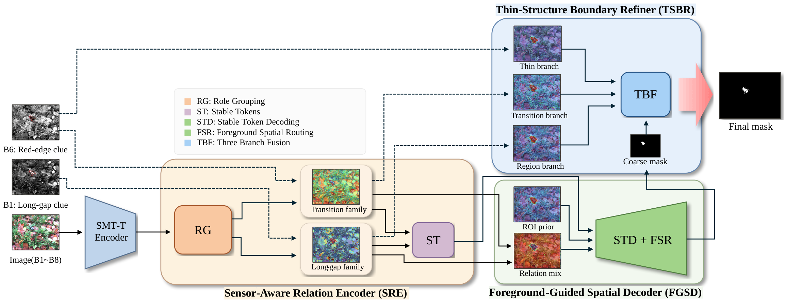
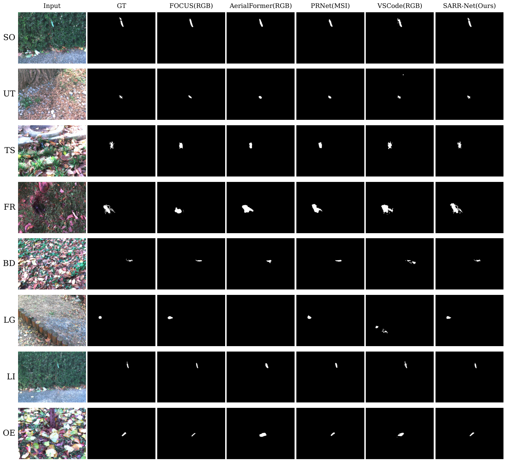
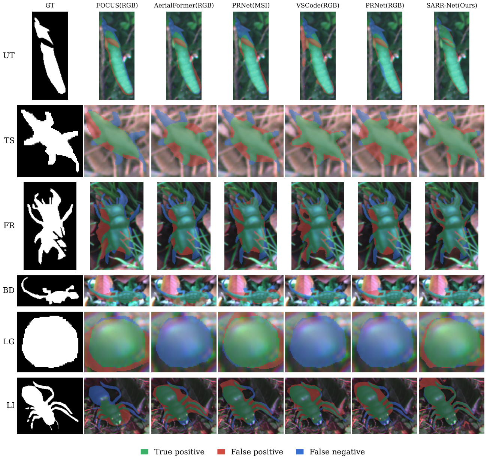

<div align="center">

<h1>SARR-Net</h1>

<h3>Sensor-Aware Relation Routing<br>for Multispectral Camouflaged Object Detection</h3>

Jisang Lee · Cheoneum Park<sup>&#42;</sup> · Haneol Jang<sup>&#42;</sup>

Department of Computer Engineering, Hanbat National University<br>
<sup>&#42;</sup>Corresponding authors

***IEEE Transactions on Multimedia* (TMM), 2026 · Accepted**

[](LICENSE)
[](#installation)
[](#installation)

</div>

<p align="center"></p>

SARR-Net segments camouflaged objects from aligned eight-band multispectral images. Objects that look like their surroundings in visible light can differ at other wavelengths; SARR-Net keeps these band-to-band relations identifiable and routes them to the spatial decisions that form the mask.

- **Sensor-Aware Relation Encoder (SRE).** Groups the eight bands into five sensor roles, builds band tokens from sensor metadata, and keeps neighboring-band (transition) and visible-to-NIR (long-gap) contrasts in separate, sensor-indexed relation slots.
- **Foreground-Guided Spatial Decoder (FGSD).** Predicts an ROI prior, mixes the two relation families by predicted regional context, keeps a compact foreground-biased memory, and passes stable relation tokens to the query decoder.
- **Thin-Structure Boundary Refiner (TSBR).** Reuses the same relation evidence in transition, region and thin-structure branches to recover object interiors, boundaries and thin parts.

On MCOD, SARR-Net with an SMT-T backbone reaches S<sub>m</sub> / E<sup>ad</sup><sub>φ</sub> / F<sup>ad</sup><sub>β</sub> of **0.8832 / 0.9701 / 0.7988** and MAE **0.0015** (mean of three runs), an 8.4% relative gain in adaptive F-measure over PRNet with an SMT-S backbone, with 18.4M parameters.

## News

- **2026-11** Code released.
- **2026-10** Paper accepted to *IEEE Transactions on Multimedia*.

## Results

MCOD test split (500 images, aligned eight-band input). Eight-band methods from Table III of the paper; SARR-Net is the mean of three runs.

| Method | Venue | S<sub>m</sub> ↑ | E<sup>ad</sup><sub>φ</sub> ↑ | F<sup>ad</sup><sub>β</sub> ↑ | MAE ↓ |
|:--|:--|:-:|:-:|:-:|:-:|
| HybridSN | GRSL 2020 | 0.6813 | 0.7007 | 0.3700 | 0.0086 |
| C2FNet | IJCAI 2021 | 0.8178 | 0.8268 | 0.5591 | 0.0033 |
| BSA-Net | AAAI 2022 | 0.7956 | 0.9291 | 0.6845 | 0.0032 |
| SINet-V2 | TPAMI 2022 | 0.7898 | 0.7389 | 0.4770 | 0.0041 |
| SpectralFormer | TGRS 2022 | 0.6103 | 0.5741 | 0.2193 | 0.0121 |
| PRNet | TCSVT 2024 | 0.8394 | 0.9490 | 0.7218 | 0.0023 |
| IdeNet | TIP 2024 | 0.8435 | 0.8696 | 0.6278 | 0.0025 |
| FIRNet | TVC 2025 | 0.7672 | 0.8102 | 0.5177 | 0.0064 |
| **SARR-Net (ours)** | TMM 2026 | **0.8832** | **0.9701** | **0.7988** | **0.0015** |

The strongest RGB method in Table II, FOCUS (DINOv2-G, AAAI 2025), reaches 0.8309 / 0.9421 / 0.7370 / 0.0024. Across the three runs, the adaptive F-measure of SARR-Net is 0.7988 ± 0.0038.

<details>
<summary>Accuracy and cost (Table IV)</summary>

| Method | Backbone | Bands | Params (M) ↓ | FLOPs (G) ↓ | FPS ↑ | F<sup>ad</sup><sub>β</sub> ↑ |
|:--|:--|:-:|:-:|:-:|:-:|:-:|
| PRNet | SMT-T | 8 | 12.7 | 18.4 | 62.4 | 0.7218 |
| PRNet | SMT-S | 8 | 23.8 | 30.4 | 36.1 | 0.7372 |
| FOCUS | DINOv2-L | 3 | 525.1 | 1051.3 | 6.1 | 0.7044 |
| FOCUS | DINOv2-G | 3 | 1386.4 | 3202.4 | 3.2 | 0.7370 |
| **SARR-Net (ours)** | SMT-T | 8 | 18.4 | 59.0 | 17.2 | **0.7988** |

Measured on an NVIDIA RTX A6000 with batch size 1 and 512 × 512 inputs.

</details>

<details>
<summary>Component ablation (Table V)</summary>

| Variant | SRE | FGSD | TSBR | S<sub>m</sub> ↑ | E<sup>ad</sup><sub>φ</sub> ↑ | F<sup>ad</sup><sub>β</sub> ↑ | F<sub>avg</sub> ↑ | MAE ↓ |
|:--|:-:|:-:|:-:|:-:|:-:|:-:|:-:|:-:|
| B0 | – | – | – | 0.8670 | 0.9592 | 0.7583 | 0.7732 | 0.0018 |
| B1 | ✓ | – | – | 0.8700 | 0.9658 | 0.7685 | 0.7822 | 0.0018 |
| B2 | ✓ | ✓ | – | 0.8818 | 0.9649 | 0.7930 | 0.8058 | 0.0016 |
| **Full** | ✓ | ✓ | ✓ | **0.8832** | **0.9701** | **0.7988** | **0.8112** | **0.0015** |

Each row is the mean of three runs.

</details>

<details>
<summary>Qualitative results (Figs. 5 and 6)</summary>

Predicted masks on the eight diagnostic subsets of the MCOD test split:

<p align="center"></p>

Local error maps (green: true positive, red: false positive, blue: false negative):

<p align="center"></p>

</details>

## Installation

Tested on Linux with 3 × NVIDIA RTX A6000 (48 GB).

| Python | PyTorch | torchvision | CUDA | timm |
|:-:|:-:|:-:|:-:|:-:|
| 3.8.16 | 2.0.0 | 0.15.1 | 11.7 | 1.0.16 |

```bash
git clone https://github.com/Kkubuck/SARR-Net.git
cd SARR-Net

conda create -n sarrnet python=3.8.16 -y
conda activate sarrnet
pip install torch==2.0.0 torchvision==0.15.1 --index-url https://download.pytorch.org/whl/cu117
pip install -r requirements.txt
```

The code also runs with newer releases (checked with Python 3.10, PyTorch 2.7 and NumPy 2.1).

## Data preparation

Download MCOD from the [official repository](https://github.com/yl2900260-bit/MCOD) and arrange it as follows. Each sample is an eight-band cube stored as a MATLAB v7.3 `.mat` file with a binary mask of the same name.

| Split | Images | Folder |
|:--|--:|:--|
| Train | 1,027 | `data/MCOD/TrainDataset` |
| Test | 500 | `data/MCOD/TestDataset` |

```text
data/MCOD/
├── TrainDataset/
│   ├── Mat/    # <id>.mat
│   └── GT/     # <id>.jpg
└── TestDataset/
    ├── Mat/
    └── GT/
```

The input normalization (Eq. 1) uses per-band 1st/99th percentiles of the training cubes, stored in [`configs/mcod_band_stats.json`](configs/mcod_band_stats.json). They can be recomputed with

```bash
python tools/compute_band_stats.py --mat_dir data/MCOD/TrainDataset/Mat --output configs/mcod_band_stats.json
```

## Training

Download the ImageNet-1K **SMT-T** weights (`smt_tiny.pth`) from the [official SMT repository](https://github.com/AFeng-x/SMT) and save them in `pretrained/`. The three-channel stem is resampled to eight bands when the weights are loaded.

```bash
CUDA_VISIBLE_DEVICES=0,1,2 python train.py --config configs/sarrnet_smt_t.yaml \
  --data_root data/MCOD --pretrained pretrained/smt_tiny.pth --output runs/sarrnet
```

| Setting | Value |
|:--|:--|
| Input | Eight bands; short side 512 (long side ≤ 2,048), bottom/right zero padding to a multiple of 32 |
| Augmentation | Random flip, border crop, rotation and mask noise |
| Optimizer | AdamW, weight decay 1e-4, element-wise gradient clipping at 0.5 |
| Learning rate | Backbone 5e-5 / other branches 2e-4, constant |
| Batch × epochs | 8 (DataParallel over 3 GPUs) × 20 |
| Loss | Eq. (19), with the weights in [`configs/sarrnet_smt_t.yaml`](configs/sarrnet_smt_t.yaml) |

`train.py` splits the global batch over all visible GPUs; a single 48 GB GPU also holds the batch of 8 (about 37 GB). The log, the resolved configuration and `sarrnet_final.pth` are written to `--output`; add `--save_every_epoch` to keep every epoch. The paper reports the mean of three runs (`--seed`; the seeds are listed in the config).

## Evaluation

```bash
python test.py --config configs/sarrnet_smt_t.yaml --data_root data/MCOD \
  --checkpoint runs/sarrnet/sarrnet_final.pth --output results/sarrnet --save_masks
```

The four predicted logits are summed, the padding is cropped, and the result is resized to the mask resolution, passed through a sigmoid and min–max normalized. `metrics.json` reports S<sub>m</sub>, E<sup>ad</sup><sub>φ</sub>, F<sup>ad</sup><sub>β</sub>, F<sub>avg</sub> and MAE; `--save_masks` writes the predictions as 8-bit PNG files.

## Inference

Predict masks for a folder of eight-band `.mat` cubes:

```bash
python tools/predict.py --checkpoint runs/sarrnet/sarrnet_final.pth \
  --input path/to/mat_cubes --output predictions/
```

Each mask is saved at the resolution of its cube. With `--gt_dir`, each cube is oriented to its mask as in `test.py`.

## Code structure

| Paper | Code |
|:--|:--|
| Percentile normalization (Eq. 1), SMT-T stages (Eq. 2), full model | [`sarrnet/models/sarr_net.py`](sarrnet/models/sarr_net.py), [`sarrnet/models/smt.py`](sarrnet/models/smt.py) |
| Sensor-Aware Relation Encoder (Sec. III-B, Eqs. 3–9) | [`sarrnet/models/sre.py`](sarrnet/models/sre.py) |
| Foreground-Guided Spatial Decoder (Sec. III-C, Eqs. 10–16) | [`sarrnet/models/fgsd.py`](sarrnet/models/fgsd.py) |
| Thin-Structure Boundary Refiner (Sec. III-D, Eqs. 17–18) | [`sarrnet/models/tsbr.py`](sarrnet/models/tsbr.py) |
| Training objective (Sec. III-E, Eq. 19) | [`sarrnet/losses.py`](sarrnet/losses.py) |
| S<sub>m</sub>, E<sup>ad</sup><sub>φ</sub>, F<sup>ad</sup><sub>β</sub>, F<sub>avg</sub>, MAE | [`sarrnet/evaluation/metrics.py`](sarrnet/evaluation/metrics.py) |

```text
SARR-Net/
├── configs/
│   ├── sarrnet_smt_t.yaml      # paper recipe
│   └── mcod_band_stats.json    # per-band percentiles of the MCOD training split
├── sarrnet/
│   ├── data/mcod.py            # .mat cubes and masks, resizing, augmentation
│   ├── evaluation/metrics.py   # S-measure, E-measure, F-measure, MAE
│   ├── models/                 # SMT-T backbone, SRE, FGSD, TSBR, SARR-Net
│   ├── losses.py               # training objective
│   └── utils.py                # configuration, model building, readout
├── tools/
│   ├── predict.py              # masks for a folder of .mat cubes
│   └── compute_band_stats.py   # normalization percentiles
├── train.py
└── test.py
```

## Citation

```bibtex
@article{lee2026sarrnet,
  title   = {{SARR-Net}: Sensor-Aware Relation Routing for Multispectral Camouflaged Object Detection},
  author  = {Lee, Jisang and Park, Cheoneum and Jang, Haneol},
  journal = {IEEE Transactions on Multimedia},
  year    = {2026},
  note    = {Accepted}
}
```

## Acknowledgements

This code builds on [SMT](https://github.com/AFeng-x/SMT), [PRNet](https://github.com/hu-xh/PRNet) and [PySODMetrics](https://github.com/lartpang/PySODMetrics), and uses the [MCOD](https://github.com/yl2900260-bit/MCOD) benchmark. We thank the authors for releasing their code and data.

## License

The code is released under the [Apache License 2.0](LICENSE). Upstream components keep their licenses ([THIRD_PARTY_NOTICES.md](THIRD_PARTY_NOTICES.md)). MCOD images in the figures remain under the dataset's CC BY-NC-ND 4.0 terms.
